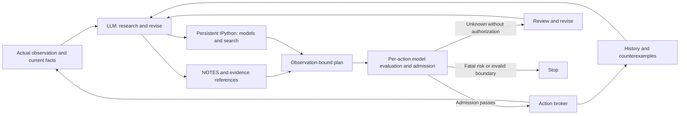

<p align="right"><strong>English</strong> | <a href="README.zh-CN.md">简体中文</a></p>

# Asterion

**A composable, multi-runtime agent application framework for sustained, evidence-driven research.**

Asterion Prime targets autonomous problem-solving for work that consumes substantial human time and effort. Its guiding purpose is long-horizon, open-ended, falsifiable computational research, producing a research chain that humans can understand, machines can check, evidence can trace, and conclusions can replay. Prime supplies reusable infrastructure; each domain supplies its research and data layers. We are first developing and testing this approach in P7 before extending it to other domains. This is the architectural direction; verified capabilities remain scoped to their recorded tests. See the [Prime architecture](docs/architecture/agent-framework.md#asterion-prime-positioning).

Asterion Prime P7 adapts that infrastructure to interactive ARC-AGI-3 games. The model owns research reasoning: it maintains useful NOTES, writes and revises programs when needed, and tests hypotheses against real observations. The application supplies game facts, authorized actions and evidence. Historical experience is available only when explicitly selected; a new research run defaults to no prior-run experience.

## Recent progress: refactored Prime, application integration and autonomous P7 completion

**The refactored Prime standard library owns backend resources, and its P7 application has completed BP35 by checkpoint continuation: local full-game score 100.000000, 9/9 levels.** The model developed its understanding, wrote and tested programs, revised hypotheses against actual feedback, and selected the actions. NOTES and persistent IPython carried the research; the application supplied observations, tools and execution boundaries.

The completed path began with a cold autonomous **L1–L6 checkpoint: 211 actions, zero deaths and zero paid RESETs**, without previous NOTES, routes, programs or outside solving assistance. Six levels were the operator's assigned target. Independent continuations then solved L7 and L8. The final L9 run restored only the isolated **335-action, eight-level prefix and its L8 NOTES**, with no prior L9 research. It needed **123 new actions**, including one death and one RESET; the winning attempt after RESET used 80 actions. The resulting **458-action trace** was sealed and independently replay-verified. The final continuation took **46 min 10.87 s**, with 40 of its 163 permitted new actions remaining.

| Milestone | Evidence and scope |
|---|---|
| Standard Prime application ownership | Task40 migrated existing P1 and P3–P7 model paths, including the P7 narrator; Task43 verified specific lifecycle, native context/checkpoint/resume and metadata repairs. Prime owns Pi/RPC, extensions, sessions, workspaces and cleanup. |
| Cold autonomous six-level checkpoint | Task29, frozen `9557ad63`: BP35 L1–L6, 211 actions, 25 min 48.25 s, zero deaths/paid RESETs; [evaluation and replay evidence](docs/reviews/2026-10-09-p7-bp35-task29-evaluation.md). |
| Full-game checkpoint continuation | Task57, frozen `7c2ad1e3`: 335 restored + 123 new actions = 458, **9/9 and local score 100.000000**; sealed trace, independent replay and cleanup verified. |
| Packaged predeath gate witness | Task59, repaired source `ebb47e7f`: real offline SDK restored the exact first 376 actions; original actor callbacks reproduced the assessment in shared IPython. Both ordinary review and the explicit probe applied zero actions; the default-zero authorization denied the probe and left the SDK frame unchanged. |

These results establish cold six-level autonomous solving and selected-checkpoint completion of all nine levels. Uninterrupted cold-start completion of all nine levels has not yet been demonstrated. The full-game result used its frozen earlier probe policy; the later stricter gate has targeted packaged verification. [Current evidence and remaining scope](docs/status/RESUME-NEXT-SESSION.md).

## ARC-AGI-3: official result

On 7 October 2026 (UTC+8), Asterion Prime P7 achieved an **official ARC-AGI-3 score of 100.00**, completing **25/25 public games and 183/183 levels in 6,781 actions**. The [Competition scorecard](https://arcprize.org/scorecards/60c10b53-9b8d-4af9-aae7-85f81543198a) is normally closed, and its final receipt has been checked against every submitted route. The research model was `gpt-6.1-sol`, seed `0`; the final execution snapshot is [`2f258ff3`](https://github.com/uukuguy/asterion/tree/2f258ff3e74478805f63e08daa437acf9ca53a21). Earlier saved routes retain their original code identities and certificates.

[](https://arcprize.org/scorecards/60c10b53-9b8d-4af9-aae7-85f81543198a)

Official result: **100.00**, 25 games, 183 levels, 6,781 actions. [Full-page screenshot](docs/assets/arc-agi-3/p7-official-scorecard-full.png).

| Evidence | Status and meaning |
|---|---|
| Local saved routes | 25 games completed; 183 levels; 6,781 selected-route actions; local aggregate 100.000000 |
| Official full-catalog submission | [Competition scorecard](https://arcprize.org/scorecards/60c10b53-9b8d-4af9-aae7-85f81543198a) **100.00**; 25/25 games, 183/183 levels, 6,781 actions; normally closed receipt checked |
| Evaluation scope | Accumulated research on the 25 public games, seed 0 |

Read the [public result record](docs/results/arc-agi-3/README.md) and [machine-readable evidence](docs/results/arc-agi-3/p7-public-2026-10-07.json). Browse saved progress and replay in the [read-only console](https://asterion-p7-console.vercel.app); synchronized data may lag local research.

This is a historical warm-start, iterative public-game research result, with retained experience, retries, verified prefix reuse, operator scheduling, and application repairs during the campaign. P7 generated research programs, WorldMaps, and action choices. The 6,781 actions describe selected routes, not all exploration or total research cost. Official saved-route submission checks those routes in new online games without model inference; it is distinct from a fresh LLM solve. No private-set result, ARC Prize Verified status, or monetary total is claimed. A [scoped API-price estimate](docs/results/arc-agi-3/README.md#scoped-api-price-estimate) gives $147.46–$158.32 at Standard rates under an assumed 97% cached-read share; actual payment and complete research cost remain unknown.

## Prime as a library, P7 as an application

The standard library entry is [`prepare_prime_application`](src/asterion/agents/prime/application.py), using `PrimeApplicationSpec`, an operator-resolved `PrimeOperatorContext`, and explicit authorization. Preparing the owner validates inputs without launching Pi. Prime subsequently owns backend launch, RPC, extension loading, persistent workspaces and cleanup. An application supplies its goals, declared tools, data, and completion/continuation hooks; it does not construct Pi/RPC objects to inject into Prime. Independent applications need no central registration or provider discovery. Existing provider/assembly routes remain available; a unified Prime CLI is outside the completed migration scope.

| Layer | Ownership |
|---|---|
| Prime infrastructure | Computation and workspace lifetime, tool transport, context archives/projection, native-session continuity, authorization and resource boundaries |
| P7 research | Research guidance, NOTES and optional WorldMap/programs, actor-model rollout integration, interpretation of observations and counterexamples |
| P7 data | Actual frames and history, game action dispatch, evidence references, selected-route certificates and replay |
| Operator | Backend configuration and credentials, exact model selection, external assets, execution authorization and stopping policy |

The operator resolves configuration and injects it; generic Prime code does not read `.env` or authentication profiles. Existing P1 and P3–P7 model paths, including the P7 narrator, use the standard resource owner. P1–P6 target `deepseek/deepseek-flash`; P7 uses `openai-codex/gpt-6.1-sol`. P2 currently remains a model-free local retrieval mechanism. These are migration boundaries, not proof of autonomous capability in every application.

Current research memory uses model-written **NOTES**, with immutable revisions and evidence references. Accepted notes can establish a working-context epoch: the current notes, necessary application state, effective constraints, recent complete tool groups, significant errors and uncertain effects remain in context, while covered older detail stays archived and readable by reference. The generic TypeScript context machinery handles archive/cursor/projection; P7 supplies the research content and exact current facts. This is separate from native compaction. Specialized code-aware summaries that preserve persistent-kernel interfaces are not yet connected to the current launch chain. Context-capacity reminders measure hook JSON bytes, not provider tokens or a proven token/cost ceiling.

## How current P7 research works



1. **Observe and retain useful understanding.** P7 appends the actual settled frame, observation reference, budget status and workspace revision to model context. The model chooses its hypotheses, representation and next experiment. NOTES hold useful mechanisms, assumptions, counterexamples, unresolved questions and next steps; detailed WorldMaps remain available rather than a mandatory reasoning form.
2. **Compute when useful.** A persistent IPython namespace holds state projections, transition functions and searches across turns. The read-only `p7_research` interface exposes actual observations and evidence. The model cannot import the game engine to search hidden state. Model-facing cell history contains actor cells with their original kernel ordinals; the private kernel archive retains host computations too.
3. **Compare predictions with evidence.** Optional reports and action predictions can be checked against recorded observations. A match supports the stated comparison; it does not establish model completeness, goal correctness, optimality or future safety. Contradictions remain available as counterexamples.
4. **Execute a current plan.** Plans bind to the exact observation and workspace revision. P7 validates the whole request before dispatching actions sequentially. Mismatch handling follows the selected profile; RESET, level boundaries, terminal conditions and unresolved effects retain their hard stops. Unexecuted suffixes stay unexecuted, and uncertain effects never authorize a retry.
5. **Keep evidence within its scope.** New research runs default to historical experience **off**. Explicit history-enabled experiments and selected resume paths can use prior material with source identities and current-state checks. Archived programs are material to inspect and revise; previous evidence cannot authorize current actions. The official campaign above used historical experience and verified prefix reuse and therefore has a different evaluation scope.

Modern standard **solve/resume/sweep and supervised research evaluate each real primitive before dispatch**, including every step of a batch. The actor registers its own frame projection and dynamics/risk callbacks in shared IPython. Rollouts apply one input and follow modeled automatic motion until a stop or unknown result, without consulting hidden engine mechanics. WorldMaps and other research representations remain optional; non-RESET action admission requires a current registered model and usable evaluation evidence. Identified `predicted_death` or `conditional_fatal` blocks the action and its suffix. RESET, level change and kernel restoration invalidate the old registration; retained fatal witnesses keep their checked applicability boundaries. Proactive actor checks and automatic host checks are recorded separately.

Incomplete coverage returns **`model-coverage-review`** before ordinary advance. An unknown probe must be one step, bind to that returned review and the exact observation/action/model/kernel, and state its goal, risk and cost. It also requires finite application-injected **`unknown_probe_action_limit`**, whose default is **0**; model text, plans and NOTES cannot grant or replenish it. Permission is consumed before dispatch, including uncertain effects. It accepts bounded unknown risk and cannot bypass missing models/checkers, failed computation, invalid evidence, fatal findings, applicability uncertainty, cancellation, unresolved execution or budget limits. An inaccurate model can still miss danger; modeled coverage is not a guarantee of safety.

The current model-facing tool surface is exactly **`ipython`, `p7_workspace`, and `p7_execute_plan`**. These are registered application tools, not prompt-only names. Research and real action dispatch have separate interfaces. Board delivery uses a lossless palette/row dictionary when smaller, with raw-frame fallback and an exact raw research reader; this changes presentation, not game semantics or recorded evidence.

**RESET starts a new environment episode.** P7 preserves raw history, completed prefixes, and durable learned observations while clearing pending probes and executable planner authority. Current-episode support must be gathered again; pre-RESET evidence cannot silently become permission to execute a new plan.

The optional `fresh-target` quarantine policy is an **operator-selected intervention** that excludes explicitly identified prior target-level material while retaining a bound earlier-level prefix. It is not an automatic P7 decision.

### Inspect the implementation

| Surface | Public source |
|---|---|
| Standard resource owner | [Application entry](src/asterion/agents/prime/application.py), [backend owner](src/asterion/agents/prime/backend.py) |
| NOTES and context continuity | [Memory store](src/asterion/applications/prime/p7/research.py), [generic projection](packages/typescript/asterion-prime-extension/src/context-projection.ts), [context witness](packages/typescript/asterion-prime-extension/src/context-witness.ts) |
| LLM guidance and registered tools | [Prompt](src/asterion/applications/prime/p7/prompt.py), [tool registry](src/asterion/applications/prime/p7/tool_registry.py), [TypeScript extension](packages/typescript/asterion-prime-extension) |
| Persistent programmatic research | [IPython host](src/asterion/applications/prime/p7/ipython_host.py), [research runtime](src/asterion/applications/prime/p7/research_runtime.py), [research bridge](src/asterion/applications/prime/p7/research_bridge.py) |
| WorldMap, checks, and actions | [Research workspace](src/asterion/applications/prime/p7/research.py), [world model](src/asterion/applications/prime/p7/world_model.py), [broker](src/asterion/applications/prime/p7/broker.py) |
| Actor-model rollouts | [Pure helpers](src/asterion/applications/prime/p7/rollout.py), [kernel integration and retained risk](src/asterion/applications/prime/p7/rollout_runtime.py) |
| Optional experience and observation delivery | [Experience loader](src/asterion/applications/prime/p7/experience.py), [induction](src/asterion/applications/prime/p7/experience_induction.py), [actor projection](src/asterion/applications/prime/p7/actor_projection.py) |
| Save-time authority and official replay | [Certificates](src/asterion/applications/prime/p7/solution_certificates.py), [official operator](src/asterion/applications/prime/p7/official_operator.py), [online replay](src/asterion/applications/prime/p7/official_replay.py) |

## Current verification boundary

The refactored system has evidence for standard resource ownership, specific context/recovery contracts, autonomous BP35 checkpoint continuation, and the current packaged unknown-probe gate. Each claim retains its code identity and execution scope:

| Claim | Supporting verification | Evaluation scope and remaining boundary |
|---|---|---|
| BP35 full-game continuation | Frozen Task57 `7c2ad1e3`, 9/9, local score 100.000000; sealed and replay-verified 458-action trace | Selected eight-level checkpoint plus new L9 research; one new death/RESET; earlier probe policy |
| Default-zero unknown-probe admission | Task59 installed repaired wheel `4ba8d6b0…`, real offline SDK at action 376, original predeath callbacks rebuilt with historical `G=-1` in shared IPython | Exact hazardous candidate through standard application `execute_plan`; no Pi/model inference or full-game run under this policy |
| Risk and terminal evidence retained separately | Task58 source/package checks and saved-result classification; Task59 freshly recomputed the complete original assessment artifact (`c239d148…`) | Conditional fatal recognition can coexist with incomplete terminal reconstruction; unresolved coverage stays unknown |
| Prime resource and context contracts | Task40 migration and Task43 named lifecycle, native context/checkpoint/resume, worker and metadata witnesses | Cross-domain research capability, complete historical migration and long-horizon cognition equivalence remain separate evaluations |

At the Task59 candidate, ordinary review returned `model-coverage-review`; the exactly bound explicit probe returned **`authorization_required`** with zero allowance. Target SDK dispatch attempts were **0**, and the observation and frame stayed unchanged. No assessment stub or backend model call was used. Backtests now retain `predicted_outcome`, `predicted_risk`, coverage, findings and raw evidence references separately; an unassessed real death is `death_not_assessed`. These checks verify admission and evidence handling, while reliable model accuracy and zero-death full-game solving remain unverified.

The October 7 official campaign retains its historical code and accumulated-research scope. Earlier interrupted trials, superseded diagnoses and exact receipts belong in the [research evidence index](docs/status/ASTERION-PRIME-P7-EVIDENCE.md), [current state](docs/status/CURRENT-STATE.md) and [session checkpoint](docs/status/RESUME-NEXT-SESSION.md). Runtime cost reporting preserves available cache categories and labels `pi_sdk_estimate` as an estimate; missing coverage and actual payment remain unknown.

## Console and replay

The [read-only console](https://asterion-p7-console.vercel.app) shows saved research progress and route replay; synchronized data may lag local research. Click either screenshot to view it at full size.

[](docs/assets/arc-agi-3/p7-console-overview.png)

Local saved-route progress: **100**, 25 games and 183 levels completed.

[](docs/assets/arc-agi-3/p7-console-game.png)

AR25 game scene, WorldMap and replay timeline from local research. Official results are documented by the scorecard above.

## Reproduce and inspect

Start with the [community reproduction guide](docs/guides/prime-p7-community-reproduction.md) for external prerequisites, exact model selection, the current OrbStack launcher, and local/official commands.

Framework inspection requires Python 3.10+ and `uv`, with no model credentials:

```bash
uv sync --frozen
uv run asterion list
uv run asterion describe --provider dci-agent-lite
```

After preparing your own Pi runtime/profile, ARC game assets and SDK wheels, operator credentials, and guest paths, run one bounded local research attempt:

```bash
make asterion-prime-p7-sync-games
make asterion-prime-p7-games
make asterion-prime-p7-level-witness GAME=ls20 LEVEL=1
make p7-controller
```

Catalog synchronization uses network GETs, without a scorecard or model. The level witness invokes the model and the OFFLINE game. `LEVEL=N` means completing levels 1 through N in order. The console serves at `http://127.0.0.1:57515/`; viewing it does not start a solve, while its explicit controls can start game work. New operators build their own research records and certified routes.

Only after preparing your own certified routes and deciding to perform an official submission:

```bash
make asterion-prime-p7-official-preflight
make asterion-prime-p7-official-submit GAME=all
```

The latter creates a new Competition scorecard and executes real online actions. Local files are not uploaded as scores. A final result comes from the closed server scorecard and checked receipt. See the [detailed operator guide](docs/guides/prime-p7-games-and-official-results.md) for single-game submission and recovery.

## The framework underneath

The authoritative distribution is the Python wheel defined by [pyproject.toml](pyproject.toml) and implemented in `src/asterion/`. Python owns orchestration, composition, assembly, and execution; TypeScript validates shared contracts and Node integration; Rust owns controlled execution.

The provider/assembly integration follows:

```text
CLI / host → selected provider → assembly → catalog / composer
           → exact implementations → runner → runtime / host services
```

Capabilities and applications use exact versioned identities. Composition rejects missing edges, ambiguity, and cycles. Framework modules remain domain-neutral; products depend on them. DCI is a reference product, not a dependency that generic framework modules assume.

The closed contracts are `asterion.agent-runtime/v1`, `asterion.capability/v1`, `asterion.capability-package/v1`, and `asterion.application-assembly/v1`. Schemas, Python/TypeScript validators, and conformance fixtures agree. Manifests express compatibility; they contain no prompts, credentials, commands, executable paths, provider settings, or mutable state.

| Implementation / application | Role |
|---|---|
| Asterion Prime (`asterion.prime`) | Reusable Prime library with private Pi/session ownership; P1–P7 are independent applications, with optional provider integration |
| Asterion Native (`asterion.native`) | Peer control-plane provider; currently not an `AgentRuntime` adapter |
| P1–P6 | Persistent computation, programmatic long context, recursive work, bounded autonomy, and continual execution |
| DCI | Reference research/evaluation/benchmark/analysis/export product |
| Controlled code | Capability execution through explicitly injected host authority |

Native Asterion Prime does not import or require external Prime Agent source or SDK code. Pi is an external transport/runtime dependency. Historical Prime Gateway comparison surfaces and mixed-repository parity results are documented separately and do not establish native capability parity.

## Safety, development, and documentation

The host owns credentials, policy, cancellation, data, and execution authority. Runners execute resolved plans sequentially; they do not discover, authorize, retry, persist, schedule, or choose runtimes. The Rust executor enforces trusted command policy, clean environments, deadlines, output caps, and cancellation; it is not an OS sandbox. Retained evidence and configuration never grant execution authority.

Public evidence excludes credentials, provider payloads, private prompts, raw research output, and private host paths. Public replay presents an application-approved projection. Runtime streams require one run identity, contiguous events, matched calls/results, and one terminal event.

Development review starts with the changed implementation and its actual boundaries. Run focused checks appropriate to that surface; documentation-only changes use `make docs-check`. Available provider-free regression commands include:

```bash
make test
make lint
make docs-check
make check
```

`make promotion-check` verifies packaged resources and distribution boundaries without publishing or calling a model provider. These checks establish their named software boundaries, not ARC benchmark performance. A new model/game trial is a separately authorized experiment; documentation maintenance or a passing local check does not start one.

- [Documentation hub](docs/README.md) and [DCI operator guide](docs/OPERATOR-GUIDE.md)
- [Framework architecture](docs/architecture/agent-framework.md) and [runtime/provider boundaries](docs/architecture/runtime-provider-boundaries.md)
- [Capability usage](docs/guides/asterion-capability-usage.md), [Agent Control Protocol](docs/architecture/AGENT-CONTROL-PROTOCOL.md), and [security](docs/security.md)
- [Research history and evidence](docs/status/ASTERION-PRIME-P7-EVIDENCE.md), including the September 2026 single-level LS20 demonstration
