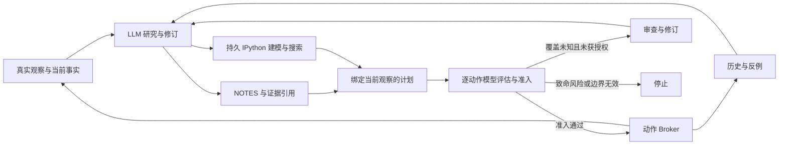

<p align="right"><a href="README.md">English</a> | <strong>简体中文</strong></p>

# Asterion

**面向持续研究、以证据驱动的可组合多运行时智能体应用框架。**

Asterion Prime 面向智能体自主解决人类需要花费大量时间与精力的问题。总体指导思想是自主开展长程、开放式、可证伪的计算研究，形成一条人类可理解、机器可复核、证据可追溯、结论可重放的推理链记录。Prime 提供通用基础设施，各领域提供研究层与数据层；当前先在 P7 上实验研究并定型，再推广到其它领域。这是架构方向，已验证能力以具体测试记录为准。参见 [Prime 架构定位](docs/architecture/agent-framework.md#asterion-prime-positioning)。

Asterion Prime P7 将通用基础设施适配到 ARC-AGI-3 交互游戏。模型负责研究推理：维护有用的 NOTES，按需编写和修订程序，用真实观察检验假说；应用提供游戏事实、授权动作与证据。历史经验仅在明确选择时提供，新研究运行默认不加载过去运行经验。

## 最新进展：Prime 重构与应用适配、P7 自主接续通关

**重构后的 Prime 标准库已统一管理底层资源，P7 应用通过 checkpoint 接续完成 BP35 整局：本地整局得分 100.000000，9/9 关。** 模型自己认识机制、编写和检验程序、根据真实反馈修订假说并选择动作。NOTES 与持久 IPython 承接研究，应用提供实际观察、工具和执行边界。

这条已完成的路径始于冷启动自主 **L1–L6 checkpoint：211 动作、零死亡、零付费 RESET**，不继承旧 NOTES、路线或程序，没有外围解题协助。六关是操作者设定的目标。后续独立接续分别完成 L7 和 L8；最后的 L9 运行仅恢复隔离的 **335 动作／八关前缀及其 L8 NOTES**，不含先前 L9 研究。模型以 **123 个新增动作**完成 L9，其中一次死亡、一次 RESET，RESET 后获胜尝试为 80 动作。累计 **458 动作的轨迹**已封存并独立重放通过。最后一次接续用时 **46 分 10.87 秒**，163 个新增动作额度还剩 40 个。

| 里程碑 | 证据与范围 |
|---|---|
| Prime 标准应用资源统一管理 | Task40 迁移 P1、P3–P7 已有模型路径，包括 P7 narrator；Task43 验证具体生命周期、原生上下文／checkpoint／resume 及 metadata 修复。Prime 管理 Pi/RPC、扩展、会话、工作区和清理。 |
| 冷启动自主六关 checkpoint | Task29，冻结 `9557ad63`：BP35 L1–L6，211 动作、25 分 48.25 秒，零死亡／付费 RESET；[评估与重放证据](docs/reviews/2026-10-09-p7-bp35-task29-evaluation.md)。 |
| checkpoint 接续整局通关 | Task57，冻结 `7c2ad1e3`：恢复 335 + 新增 123 = 458 动作，**9/9、本地得分 100.000000**；封存、独立重放及清理核验通过。 |
| 打包版本死亡前门禁见证 | Task59，修正源码 `ebb47e7f`：真实离线 SDK 精确恢复前 376 动作，原 actor callbacks 在共享 IPython 中复现评估。普通审查与明确探针均执行零动作，缺省零额度授权拒绝探针，SDK 画面未变。 |

这些结果证明冷启动六关自主解题，以及选定 checkpoint 接续完成全部九关。一次不间断的冷启动九关完整通关仍未验证。整局成功属于冻结版本的旧探针策略；后续更严格门禁已完成定向打包验证。[当前证据与未完成范围](docs/status/RESUME-NEXT-SESSION.md)。

## ARC-AGI-3 官方评测结果

**2026 年 10 月 7 日（UTC+8），Asterion Prime P7 在 ARC-AGI-3 官方评测中取得 100.00 分**，完成 **25/25 道公开题、183/183 关，共 6,781 次动作**。[Competition 成绩卡](https://arcprize.org/scorecards/60c10b53-9b8d-4af9-aae7-85f81543198a)已正常关闭，最终回执与每题提交路线逐项核对通过。研究模型为 `gpt-6.1-sol`、seed `0`；最终执行版本为 [`2f258ff3`](https://github.com/uukuguy/asterion/tree/2f258ff3e74478805f63e08daa437acf9ca53a21)。此前保存的路线保留原始代码身份和认证。

[](https://arcprize.org/scorecards/60c10b53-9b8d-4af9-aae7-85f81543198a)

官方结果：**100.00 分**、25 题、183 关、6,781 次动作。[完整网页截图](docs/assets/arc-agi-3/p7-official-scorecard-full.png)。

| 证据 | 状态及含义 |
|---|---|
| 本地保存路线 | 25 题全通、183 关、6,781 个选定路线动作、本地汇总 100.000000 |
| 官方完整目录提交 | [Competition 成绩卡](https://arcprize.org/scorecards/60c10b53-9b8d-4af9-aae7-85f81543198a) **100.00 分**；25/25 游戏、183/183 关、6,781 次动作；成绩卡正常关闭、回执核对通过 |
| 评估范围 | 在 25 道公开题上累计研究，seed 0 |

查看[公开结果说明](docs/results/arc-agi-3/README.md)及[机器可读证据](docs/results/arc-agi-3/p7-public-2026-10-07.json)。[只读控制台](https://asterion-p7-console.vercel.app)展示保存进度和回放；它通过同步更新，可能落后于本地研究。

这是历史上复用既有经验的公开题迭代研究结果，包含经验积累、重试、已验证前缀复用、操作者调度及研究中途的应用修复。P7 生成研究程序、WorldMap 和行动选择。6,781 个动作指选定路线，不包含所有探索，也不是研究总成本。官方保存路线提交不调用模型，在新的在线局中核对路线有效性，与全新 LLM 求解口径不同。本页不宣称私有题结果、ARC Prize Verified 身份或货币总成本。[限定范围的 API 价格折算](docs/results/arc-agi-3/README.md#scoped-api-price-estimate)在假设 97% 输入为缓存读取时，Standard 费用为 $147.46–$158.32；实际支付与完整研究成本仍未知。

## Prime 标准库与 P7 应用

标准库入口是 [`prepare_prime_application`](src/asterion/agents/prime/application.py)，接收 `PrimeApplicationSpec`、操作者解析的 `PrimeOperatorContext` 与显式授权。准备 owner 只校验输入，不启动 Pi；后续后端启动、RPC、扩展加载、持久工作区和清理由 Prime 管理。应用提供领域目标、声明的工具、数据及完成／续跑 hooks，不自行创建 Pi/RPC 对象注入 Prime。独立应用无需中央注册或 Provider 发现；既有 Provider／assembly 路线保留，统一 Prime CLI 不在已完成迁移范围内。

| 层 | 所有权 |
|---|---|
| Prime 通用基础设施 | 计算与工作区生命周期、工具传输、上下文归档／投影、原生会话连续性、授权与资源边界 |
| P7 研究层 | 研究指导、NOTES 与可选 WorldMap／程序、模型推演适配、观察和反例的解释 |
| P7 数据层 | 真实画面和历史、游戏动作派发、证据引用、选定路线认证与重放 |
| 操作者 | 后端配置与凭据、精确模型选择、外部资源、执行授权与停止策略 |

操作者解析配置后注入，通用 Prime 不读取 `.env` 或认证 profile。P1、P3–P7 已有模型路径，包括 P7 narrator，已迁入标准资源 owner。P1–P6 目标模型为 `deepseek/deepseek-flash`，P7 为 `openai-codex/gpt-6.1-sol`；P2 当前仍是无模型的本地检索机制。这些是迁移范围，不证明每个应用都已具备自主研究能力。

当前研究记忆以模型维护的 **NOTES** 为主，保留不可变修订与证据引用。已接受的笔记可建立工作上下文 epoch：当前笔记、必要应用状态、有效约束、近期完整工具组、重要错误及未知执行结果继续进入上下文；已覆盖的旧明细归档并可按引用读取。通用 TypeScript 机制负责 archive／cursor／projection，P7 提供研究内容与准确当前事实。该机制与原生压缩分开；保留持久内核接口的专用代码摘要尚未接入当前启动链。上下文容量提醒按 hook JSON bytes 计量，不是 Provider tokens，也不是已证明的 token／费用硬上限。

## 当前 P7 研究方法



1. **观察并保留有用认识。** P7 直接向模型上下文追加真实稳定帧、观察引用、预算状态及工作区版本。模型自行选择假说、表示与下一项实验；NOTES 保留有用机制、假设、反例、未知和下一步。详细 WorldMap 仍可使用，不是强制推理形式。
2. **按需计算。** 持久 IPython namespace 跨回合保存状态投影、转移函数与搜索程序。只读 `p7_research` 提供真实观察和证据，模型不能导入游戏引擎搜索隐藏状态。模型可见 cell 历史只包含 actor cells，保留原始 kernel 序号；私有 kernel 归档同时保留宿主计算。
3. **将预测与证据比较。** 可选报告及动作预测可与真实记录核对。吻合仅支持相应比较，不证明模型完整、目标正确、路线最优或未来安全；矛盾作为反例保留。
4. **执行当前计划。** 计划绑定精确观察和工作区版本，P7 先校验完整请求，再顺序派发动作。失配处理取决于所选 profile；RESET、换关、终局及未知执行结果继续保留硬停止。未执行后缀不算已执行，未知结果从不授权重派。
5. **按来源和范围使用证据。** 新研究运行默认历史经验 **off**。明确启用历史的实验及选定 resume 路径，可在来源身份和当前状态核对下使用旧资料。旧程序用于检查与修订；旧证据不能授权本次动作。上方官方研究使用历史经验和已核对前缀复用，评估口径与当前全新运行不同。

现代标准 **solve／resume／sweep 与监督研究都在每个真实动作前自动评估**，批计划中的每一步也分别执行。actor 在共享 IPython 中登记自己编写的画面投影、动力学和风险 callbacks；推演施加一次输入，展开模型中的自动运动直到停止或未知，不访问隐藏引擎机制。WorldMap 等研究表示仍可按需选择；非 RESET 动作准入要求当前已登记模型及可用评估证据。识别出 `predicted_death` 或 `conditional_fatal` 时阻止该步与后缀。RESET、换关和内核恢复使旧登记失效，保留的致命风险见证继续受经核对的适用范围约束。actor 主动检查与宿主自动检查独立记账。

覆盖不完整时，普通推进先返回 **`model-coverage-review`**，不派发动作。未知探针必须为单步，绑定该审查及精确观察／动作／模型／内核，并说明目标、风险与代价；还须应用注入有限 **`unknown_probe_action_limit`**，缺省为 **0**，模型文字、计划和 NOTES 不能授予或补充额度。额度在派发前消耗，执行结果未知也不退还。它接受有限未知风险，不能绕过缺失模型／检查器、计算失败、非法证据、致命发现、适用性未知、取消、执行未知或预算边界。错误模型仍可能漏掉危险；模型声明覆盖完整不保证安全。

当前模型工具面恰为 **`ipython`、`p7_workspace`、`p7_execute_plan`**，通过应用实际注册，不靠提示词假装工具。研究计算和真实动作派发有独立接口。画面在更省空间时采用无损调色板与行字典表示，否则返回原始帧；研究接口可读取精确原始画面。此投影只改变呈现，不改游戏语义或记录证据。

**RESET 是环境 episode 边界。** 原始历史、已完成前缀和持久学习记录保留，待执行探针及规划执行权限清除。新 episode 的支持证据需重新获得，RESET 前的证据不能悄然变成本次计划的执行许可。

可选的 `fresh-target` 隔离策略由**操作者明确选择**：排除指定的旧目标关材料，同时保留绑定的前面关卡前缀。它不是 P7 自动作出的决定。

### 检查实现

| 表面 | 公开源码 |
|---|---|
| 标准资源 owner | [应用入口](src/asterion/agents/prime/application.py)、[后端 owner](src/asterion/agents/prime/backend.py) |
| NOTES 与上下文连续性 | [记忆存储](src/asterion/applications/prime/p7/research.py)、[通用投影](packages/typescript/asterion-prime-extension/src/context-projection.ts)、[上下文见证](packages/typescript/asterion-prime-extension/src/context-witness.ts) |
| LLM 指导与工具注册 | [Prompt](src/asterion/applications/prime/p7/prompt.py)、[工具注册表](src/asterion/applications/prime/p7/tool_registry.py)、[TypeScript 扩展](packages/typescript/asterion-prime-extension) |
| 持久程序研究 | [IPython host](src/asterion/applications/prime/p7/ipython_host.py)、[研究运行时](src/asterion/applications/prime/p7/research_runtime.py)、[研究桥接](src/asterion/applications/prime/p7/research_bridge.py) |
| WorldMap、核对与动作 | [研究工作区](src/asterion/applications/prime/p7/research.py)、[World model](src/asterion/applications/prime/p7/world_model.py)、[Broker](src/asterion/applications/prime/p7/broker.py) |
| Actor 模型推演 | [纯推演助手](src/asterion/applications/prime/p7/rollout.py)、[内核接线与保留风险](src/asterion/applications/prime/p7/rollout_runtime.py) |
| 可选经验与观察交付 | [经验加载](src/asterion/applications/prime/p7/experience.py)、[归纳](src/asterion/applications/prime/p7/experience_induction.py)、[Actor projection](src/asterion/applications/prime/p7/actor_projection.py) |
| 保存认证与官方重放 | [认证](src/asterion/applications/prime/p7/solution_certificates.py)、[官方操作入口](src/asterion/applications/prime/p7/official_operator.py)、[在线重放](src/asterion/applications/prime/p7/official_replay.py) |

## 当前验证边界

重构后的系统已有标准资源管理、具体上下文／恢复合同、BP35 自主 checkpoint 接续及当前打包未知探针门禁的验证。每项结论保留对应代码身份与执行范围：

| 结论 | 支持证据 | 验证范围与后续边界 |
|---|---|---|
| BP35 接续整局通关 | 冻结 Task57 `7c2ad1e3`，9/9、本地得分 100.000000，458 动作轨迹封存及重放通过 | 选定八关 checkpoint 加新增 L9 研究；一次新增死亡／RESET；旧探针策略 |
| 未知探针缺省零额度准入 | Task59 安装修正 wheel `4ba8d6b0…`，真实离线 SDK 恢复至动作 376，原死亡前 callbacks 按历史 `G=-1` 在共享 IPython 重建 | 精确危险候选通过标准应用 `execute_plan`；未调用 Pi／模型推理，未在新策略下重跑整局 |
| 风险与终局证据分别保留 | Task58 源码／打包检查与已存结果分类；Task59 新计算完整复现原评估 artifact（`c239d148…`） | 已识别条件性致命风险仍可能未完整重建终局轨迹；覆盖未解决继续为 unknown |
| Prime 资源与上下文合同 | Task40 迁移及 Task43 具名生命周期、原生上下文／checkpoint／resume、worker 与 metadata 见证 | 跨领域研究能力、完整历史迁移等价及长程认知等价需独立评估 |

Task59 的普通审查返回 `model-coverage-review`；精确绑定的明确探针因零额度返回 **`authorization_required`**。目标 SDK 派发尝试为 **0**，观察和画面未变，未使用评估桩或后端模型调用。回测现分别保留 `predicted_outcome`、`predicted_risk`、coverage、findings 与原始证据引用，未评估动作的真实死亡记为 `death_not_assessed`。这些检查验证准入和证据处理；模型的普遍准确性与整局零死亡求解仍未验证。

10 月 7 日官方研究保留其历史代码与累计研究口径。此前中止试验、已替代诊断及精确回执见[研究证据索引](docs/status/ASTERION-PRIME-P7-EVIDENCE.md)、[当前状态](docs/status/CURRENT-STATE.md)和[会话 checkpoint](docs/status/RESUME-NEXT-SESSION.md)。运行费用记录保留可用缓存分类，`pi_sdk_estimate` 明确为估算；缺失覆盖与实际支付仍未知。

## 控制台与回放

[只读控制台](https://asterion-p7-console.vercel.app)展示保存的研究进度与路线回放；同步数据可能落后于本地研究。点击截图可查看原图。

[](docs/assets/arc-agi-3/p7-console-overview.png)

本地保存路线进度：**100 分**，完成 25 题、183 关。

[](docs/assets/arc-agi-3/p7-console-game.png)

AR25 本地研究的游戏场景、WorldMap 与回放时间线；官方结果以本页上方的成绩卡为证。

## 复现与检查

先阅读[社区复现指南](docs/guides/prime-p7-community-reproduction.md)，其中列明外部资源、准确模型选择、当前 OrbStack 启动入口，以及本地／官方运行命令。

框架只读检查需要 Python 3.10+ 和 `uv`，不需要模型凭据：

```bash
uv sync --frozen
uv run asterion list
uv run asterion-dci describe
```

准备好自己的 Pi 运行时与 profile、ARC 游戏资源和 SDK wheels、操作者凭据及 guest 路径后，执行一次有限本地研究：

```bash
make asterion-prime-p7-sync-games
make asterion-prime-p7-games
make asterion-prime-p7-level-witness GAME=ls20 LEVEL=1
make p7-controller
```

目录同步仅发出网络 GET，不建成绩卡、不调用模型。Level witness 调用模型和 OFFLINE 游戏；`LEVEL=N` 表示顺序完成第 1 至第 N 关。控制台地址为 `http://127.0.0.1:57515/`，查看页面不会自动解题，显式操作可以启动游戏工作。新操作者通过运行系统积累自己的研究记录和认证路线。

只有准备好自己的认证路线、并决定进行官方提交之后，再执行：

```bash
make asterion-prime-p7-official-preflight
make asterion-prime-p7-official-submit GAME=all
```

后一个命令会创建新的 Competition 成绩卡并执行真实在线动作，不上传本地文件作为成绩。最终结果来自关闭后的服务端成绩卡和核对回执。单题提交与恢复流程见[详细操作指南](docs/guides/prime-p7-games-and-official-results.md)。

## 底层框架

权威发布物是根 [pyproject.toml](pyproject.toml) 定义、`src/asterion/` 实现的 Python wheel。Python 负责编排、组合、装配和执行；TypeScript 验证共享协议及 Node 集成；Rust 负责受控执行。

Provider／assembly 集成遵循：

```text
CLI / 宿主 → 已选择 Provider → 装配 → catalog / composer
           → 精确实现 → runner → runtime / 宿主服务
```

能力与应用使用精确版本身份，装配拒绝缺边、歧义和依赖环。通用框架模块保持领域中立，产品依赖框架。DCI 是参考产品，不能成为通用框架默认依赖。

封闭协议为 `asterion.agent-runtime/v1`、`asterion.capability/v1`、`asterion.capability-package/v1` 和 `asterion.application-assembly/v1`；schema、Python/TypeScript 验证器及一致性夹具须一致。Manifest 只描述兼容性，不包含提示词、凭据、命令、可执行路径、Provider 设置或可变状态。

| 实现／应用 | 职责 |
|---|---|
| Asterion Prime（`asterion.prime`） | 管理私有 Pi／session 的通用 Prime 标准库；P1–P7 是独立应用，可选 Provider 集成 |
| Asterion Native（`asterion.native`） | 同级控制面 Provider，目前不是 `AgentRuntime` 适配器 |
| P1–P6 | 持久计算、程序化长上下文、递归工作、有界自治与持续执行 |
| DCI | 研究、评估、基准、分析和导出的参考产品 |
| Controlled code | 通过显式注入的宿主权限执行能力 |

原生 Asterion Prime 不导入或依赖外部 Prime Agent 源码与 SDK；Pi 是外部传输／运行时依赖。历史 Prime Gateway 对照及混合仓库 parity 结果独立归档，不能证明原生能力对等。

## 安全、开发与文档

宿主掌握凭据、策略、取消、数据与执行权限。Runner 顺序执行已解析计划，不负责发现、授权、重试、持久化、调度或选择运行时。Rust executor 强制可信命令策略、清空环境、超时、输出上限和取消，但不是 OS 沙箱。保存证据和配置从不授予执行权限。

公开证据排除凭据、Provider 载荷、私有提示词、原始研究输出和私有宿主路径；公开回放展示应用批准的投影。运行时流必须有单一运行身份、连续事件、配对调用／结果和唯一终态。

研发复审首先检查变更实现及其实际边界，按表面选择定向检查；纯文档变更运行 `make docs-check`。可用的 provider-free 回归命令包括：

```bash
make test
make lint
make docs-check
make check
```

`make promotion-check` 验证打包资源与发布边界，不发布、不调用模型。上述检查只证明对应软件边界，不能替代 ARC 实测成绩。新模型／游戏实跑属于另行授权的实验；文档维护或本地检查通过不会启动实跑。

- [文档入口](docs/README.md)、[DCI 操作指南](docs/OPERATOR-GUIDE.md)
- [框架架构](docs/architecture/agent-framework.md)、[运行时与 Provider 边界](docs/architecture/runtime-provider-boundaries.md)
- [能力使用](docs/guides/asterion-capability-usage.md)、[Agent Control Protocol](docs/architecture/AGENT-CONTROL-PROTOCOL.md)、[安全](docs/security.md)
- [研究历史与证据](docs/status/ASTERION-PRIME-P7-EVIDENCE.md)，包含 2026 年 9 月的 LS20 单关演示
