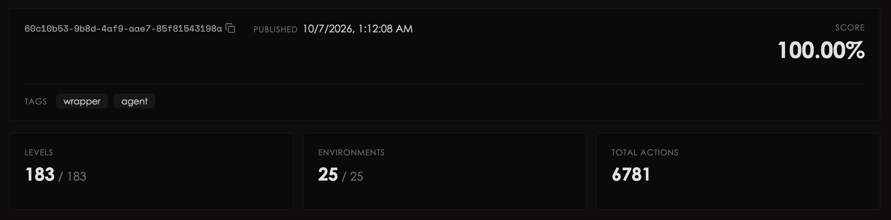
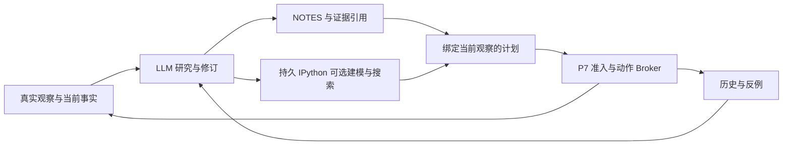
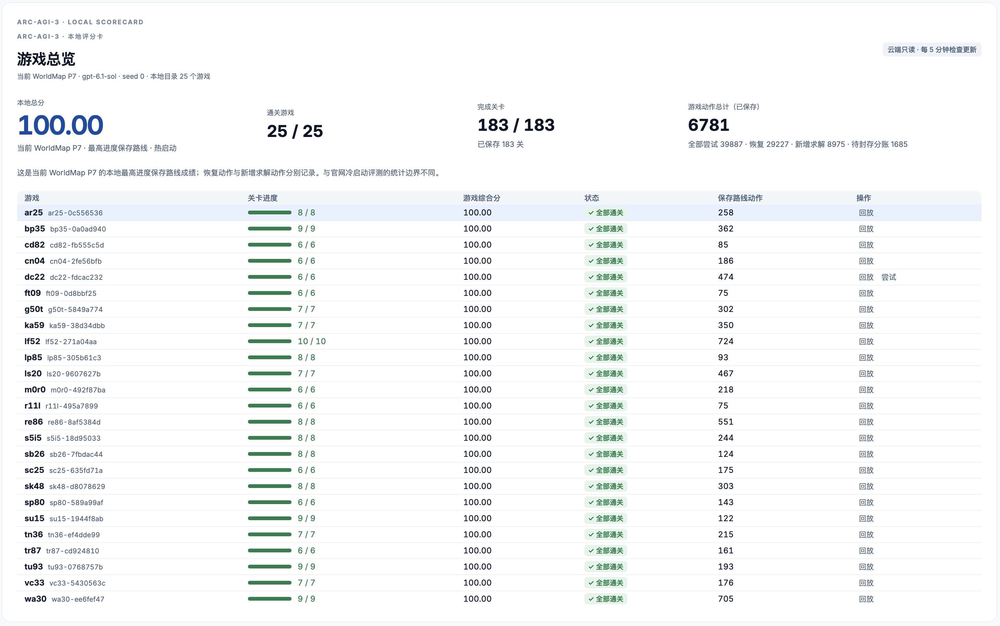
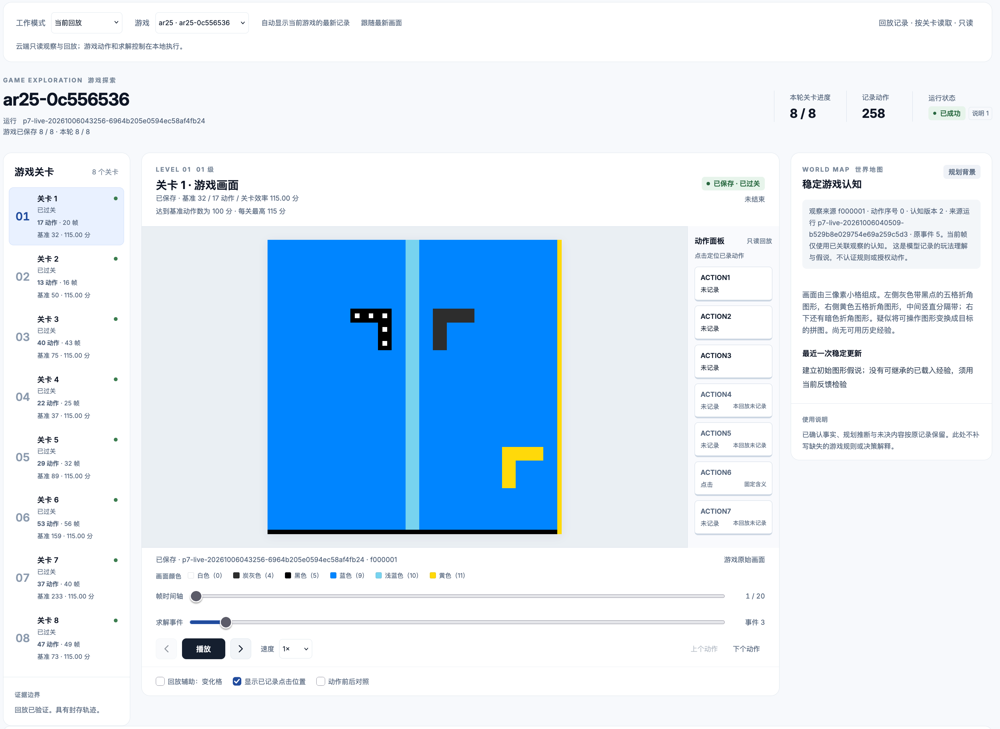

<p align="right"><a href="README.md">English</a> | <strong>简体中文</strong></p>

# Asterion

**面向持续研究、以证据驱动的可组合多运行时智能体应用框架。**

Asterion Prime 面向智能体自主解决人类需要花费大量时间与精力的问题。总体指导思想是自主开展长程、开放式、可证伪的计算研究，形成一条人类可理解、机器可复核、证据可追溯、结论可重放的推理链记录。Prime 提供通用基础设施，各领域提供研究层与数据层；当前先在 P7 上实验研究并定型，再推广到其它领域。这是架构方向，已验证能力以具体测试记录为准。参见 [Prime 架构定位](docs/architecture/agent-framework.md#asterion-prime-positioning)。

Asterion Prime P7 将通用基础设施适配到 ARC-AGI-3 交互游戏。模型负责研究推理：维护有用的 NOTES，按需编写和修订程序，用真实观察检验假说；应用提供游戏事实、授权动作与证据。历史经验仅在明确选择时提供，新研究运行默认不加载过去运行经验。

## 最新进展：Prime 重构、应用适配与 P7 全新状态自主解题

**Prime 已形成标准应用入口并统一管理底层资源，P7 已完成接入适配；P7 已实证从全新研究状态自主完成多关目标。** 模型自己认识机制、编写和检验程序、修订错误假说并选择真实动作；应用通过可复用的 Prime 基础设施提供领域目标、工具和实际观察。

- **通用应用底座。** P1、P3–P7 已有真实模型路径使用 Prime 标准资源 owner，由 Prime 管理 Pi/RPC、扩展、会话／工作区生命周期和清理，P7 研究 actor 与 narrator 均已接入。独立应用可直接使用标准库。
- **持续自主研究。** 模型编写的 NOTES 承接有用认识，持久 IPython 支持可执行假说和搜索；完整证据按引用保留。P7 提供真实反馈与反例，Prime 管理通用上下文和执行机制。
- **全新状态自主过关已有实测。** 冻结版本的 BP35 冷启动中，P7 不继承旧 NOTES、路线或程序，在没有外围解题提示、运行中代码修改或人工接管的条件下，以 **211 动作、零死亡、零付费 RESET 自主完成 L1–L6**，达成人为设定的六关 checkpoint。实际轨迹经独立重放和封存核验。[冷测证据](docs/reviews/2026-10-09-p7-bp35-task29-evaluation.md)。

| 已取得的进展 | 实测范围 |
|---|---|
| 已完成冷启动自主 checkpoint（L1–L6） | 2026-10-09，冻结 `9557ad63`：BP35 L1–L6，211 动作、25 分 48.25 秒，不继承研究状态，无外围解题协助 |
| 更快完成同一 checkpoint | 2026-10-08，冻结 `9b62d2c2`：221 动作、17 分 3.28 秒、两次付费 RESET；[过程与重放核验](docs/reviews/2026-10-08-p7-continuity-bp35-comparison.md) |
| 应用适配后的全新状态解题 | Task52，冻结 `cb0ba4ec`：无历史经验、无 resume 完成 L1–L5，九关试验在 L6 被用户中止 |
| 选定 checkpoint 的接续 | Task54 恢复已认证七关前缀，L8 以 55 个新增动作、零死亡完成，达到 8/9；L9 新增 186 动作、三次死亡后到达 60 分钟期限。Task53 恢复 L1–L6 后，以 69 个新增动作自主完成 L7；L8 执行 23 动作后，被旧 128 次调用限制终止。七关前缀重放通过。 |
| 标准入口与应用适配 | Task40 入口／资源迁移和有限 P7 打包部署；Task43 具体生命周期／上下文兼容修复 |

**前六关是已完成的自主研究 checkpoint，由操作者人为设定；它不是解题上限，也不是整局通关失败。** P7 自主完成了全部指定的 L1–L6 目标，试验随后按配置结束，保留轨迹与研究记录，供后续接续 L7–L9。这证明了全新状态下指定目标的自主完成，不能据此判断 P7 无法通过剩余关卡。后续 Task52 九关试验因耗时在 L6 被用户主动中止，也没有运行至整局终态。已记录的完整 9/9 使用了历史经验，它与下方历史官方成绩分别保留各自的评估口径。

## ARC-AGI-3 官方评测结果

**2026 年 10 月 7 日（UTC+8），Asterion Prime P7 在 ARC-AGI-3 官方评测中取得 100.00 分**，完成 **25/25 道公开题、183/183 关，共 6,781 次动作**。[Competition 成绩卡](https://arcprize.org/scorecards/60c10b53-9b8d-4af9-aae7-85f81543198a)已正常关闭，最终回执与每题提交路线逐项核对通过。研究模型为 `gpt-6.1-sol`、seed `0`；最终执行版本为 [`2f258ff3`](https://github.com/uukuguy/asterion/tree/2f258ff3e74478805f63e08daa437acf9ca53a21)。此前保存的路线保留原始代码身份和认证。

[](https://arcprize.org/scorecards/60c10b53-9b8d-4af9-aae7-85f81543198a)

官方结果：**100.00 分**、25 题、183 关、6,781 次动作。[完整网页截图](docs/assets/arc-agi-3/p7-official-scorecard-full.png)。

| 证据 | 状态及含义 |
|---|---|
| 本地保存路线 | 25 题全通、183 关、6,781 个选定路线动作、本地汇总 100.000000 |
| 官方完整目录提交 | [Competition 成绩卡](https://arcprize.org/scorecards/60c10b53-9b8d-4af9-aae7-85f81543198a) **100.00 分**；25/25 游戏、183/183 关、6,781 次动作；成绩卡正常关闭、回执核对通过 |
| 评估范围 | 在 25 道公开题上累计研究，seed 0 |

查看[公开结果说明](docs/results/arc-agi-3/README.md)及[机器可读证据](docs/results/arc-agi-3/p7-public-2026-10-07.json)。[只读控制台](https://asterion-p7-console.vercel.app)展示保存进度和回放；它通过同步更新，可能落后于本地研究。

这是历史上复用既有经验的公开题迭代研究结果，包含经验积累、重试、已验证前缀复用、操作者调度及研究中途的应用修复。P7 生成研究程序、WorldMap 和行动选择。6,781 个动作指选定路线，不包含所有探索，也不是研究总成本。官方保存路线提交不调用模型，在新的在线局中核对路线有效性，与全新 LLM 求解口径不同。本页不宣称私有题结果、ARC Prize Verified 身份或货币总成本。[限定范围的 API 价格折算](docs/results/arc-agi-3/README.md#scoped-api-price-estimate)在假设 97% 输入为缓存读取时，Standard 费用为 $147.46–$158.32；实际支付与完整研究成本仍未知。

## Prime 标准库与 P7 应用

标准库入口是 [`prepare_prime_application`](src/asterion/agents/prime/application.py)，接收 `PrimeApplicationSpec`、操作者解析的 `PrimeOperatorContext` 与显式授权。准备 owner 只校验输入，不启动 Pi；后续后端启动、RPC、扩展加载、持久工作区和清理由 Prime 管理。应用提供领域目标、声明的工具、数据及完成／续跑 hooks，不自行创建 Pi/RPC 对象注入 Prime。独立应用无需中央注册或 Provider 发现；既有 Provider／assembly 路线保留，统一 Prime CLI 不在已完成迁移范围内。

| 层 | 所有权 |
|---|---|
| Prime 通用基础设施 | 计算与工作区生命周期、工具传输、上下文归档／投影、原生会话连续性、授权与资源边界 |
| P7 研究层 | 研究指导、NOTES 与可选 WorldMap／程序、模型推演适配、观察和反例的解释 |
| P7 数据层 | 真实画面和历史、游戏动作派发、证据引用、选定路线认证与重放 |
| 操作者 | 后端配置与凭据、精确模型选择、外部资源、执行授权与停止策略 |

操作者解析配置后注入，通用 Prime 不读取 `.env` 或认证 profile。P1、P3–P7 已有模型路径，包括 P7 narrator，已迁入标准资源 owner。P1–P6 目标模型为 `deepseek/deepseek-flash`，P7 为 `openai-codex/gpt-6.1-sol`；P2 当前仍是无模型的本地检索机制。这些是迁移范围，不证明每个应用都已具备自主研究能力。

当前研究记忆以模型维护的 **NOTES** 为主，保留不可变修订与证据引用。已接受的笔记可建立工作上下文 epoch：当前笔记、必要应用状态、有效约束、近期完整工具组、重要错误及未知执行结果继续进入上下文；已覆盖的旧明细归档并可按引用读取。通用 TypeScript 机制负责 archive／cursor／projection，P7 提供研究内容与准确当前事实。该机制与原生压缩分开；保留持久内核接口的专用代码摘要尚未接入当前启动链。上下文容量提醒按 hook JSON bytes 计量，不是 Provider tokens，也不是已证明的 token／费用硬上限。

## 当前 P7 研究方法



1. **观察并保留有用认识。** P7 直接向模型上下文追加真实稳定帧、观察引用、预算状态及工作区版本。模型自行选择假说、表示与下一项实验；NOTES 保留有用机制、假设、反例、未知和下一步。详细 WorldMap 仍可使用，不是强制推理形式。
2. **按需计算。** 持久 IPython namespace 跨回合保存状态投影、转移函数与搜索程序。只读 `p7_research` 提供真实观察和证据，模型不能导入游戏引擎搜索隐藏状态。模型可见 cell 历史只包含 actor cells，保留原始 kernel 序号；私有 kernel 归档同时保留宿主计算。
3. **将预测与证据比较。** 可选报告及动作预测可与真实记录核对。吻合仅支持相应比较，不证明模型完整、目标正确、路线最优或未来安全；矛盾作为反例保留。
4. **执行当前计划。** 计划绑定精确观察和工作区版本，P7 先校验完整请求，再顺序派发动作。失配处理取决于所选 profile；RESET、换关、终局及未知执行结果继续保留硬停止。未执行后缀不算已执行，未知结果从不授权重派。
5. **按来源和范围使用证据。** 新研究运行默认历史经验 **off**。明确启用历史的实验及选定 resume 路径，可在来源身份和当前状态核对下使用旧资料。旧程序用于检查与修订；旧证据不能授权本次动作。上方官方研究使用历史经验和已核对前缀复用，评估口径与当前全新运行不同。

监督研究还提供 **actor 模型推演**：actor 显式登记当前 kernel 中自己编写的画面投影、动力学和风险 callbacks。助手施加一次输入，再展开模型中的自动运动直到停止或未知，不访问隐藏引擎机制。每次真实动作前，宿主按登记模型自动评估，发现 `predicted_death` 或 `conditional_fatal` 时阻止该步及后缀并返回证据；普通覆盖不完整明确报告，无模型为 `not_evaluated`。RESET、换关和内核恢复使旧登记失效。保留的致命风险见证有狭窄且经核对的适用范围，范围不可用时停止受影响候选。actor 主动检查与宿主自动检查独立记账。错误模型仍可能漏掉真实危险，模型未发现风险不是安全证书。这些实验指导只追加到监督研究入口。

当前模型工具面恰为 **`ipython`、`p7_workspace`、`p7_execute_plan`**，通过应用实际注册，不靠提示词假装工具。研究计算和真实动作派发有独立接口。画面在更省空间时采用无损调色板与行字典表示，否则返回原始帧；研究接口可读取精确原始画面。此投影只改变呈现，不改游戏语义或记录证据。

**RESET 是环境 episode 边界。** 原始历史、已完成前缀和持久学习记录保留，待执行探针及规划执行权限清除。新 episode 的支持证据需重新获得，RESET 前的证据不能悄然变成本次计划的执行许可。

可选的 `fresh-target` 隔离策略由**操作者明确选择**：排除指定的旧目标关材料，同时保留绑定的前面关卡前缀。它不是 P7 自动作出的决定。

### 检查实现

| 表面 | 公开源码 |
|---|---|
| 标准资源 owner | [应用入口](src/asterion/agents/prime/application.py)、[后端 owner](src/asterion/agents/prime/backend.py) |
| NOTES 与上下文连续性 | [记忆存储](src/asterion/applications/prime/p7/research.py)、[通用投影](packages/typescript/asterion-prime-extension/src/context-projection.ts)、[上下文见证](packages/typescript/asterion-prime-extension/src/context-witness.ts) |
| LLM 指导与工具注册 | [Prompt](src/asterion/applications/prime/p7/prompt.py)、[工具注册表](src/asterion/applications/prime/p7/tool_registry.py)、[TypeScript 扩展](packages/typescript/asterion-prime-extension) |
| 持久程序研究 | [IPython host](src/asterion/applications/prime/p7/ipython_host.py)、[研究运行时](src/asterion/applications/prime/p7/research_runtime.py)、[研究桥接](src/asterion/applications/prime/p7/research_bridge.py) |
| WorldMap、核对与动作 | [研究工作区](src/asterion/applications/prime/p7/research.py)、[World model](src/asterion/applications/prime/p7/world_model.py)、[Broker](src/asterion/applications/prime/p7/broker.py) |
| Actor 模型推演 | [纯推演助手](src/asterion/applications/prime/p7/rollout.py)、[内核接线与保留风险](src/asterion/applications/prime/p7/rollout_runtime.py) |
| 可选经验与观察交付 | [经验加载](src/asterion/applications/prime/p7/experience.py)、[归纳](src/asterion/applications/prime/p7/experience_induction.py)、[Actor projection](src/asterion/applications/prime/p7/actor_projection.py) |
| 保存认证与官方重放 | [认证](src/asterion/applications/prime/p7/solution_certificates.py)、[官方操作入口](src/asterion/applications/prime/p7/official_operator.py)、[在线重放](src/asterion/applications/prime/p7/official_replay.py) |

## 当前验证边界

10 月 7 日官方结果属于记录中的历史代码和研究过程，不能认证重构后的当前系统。Task40 在注明的源码、打包资源及有限 P7 部署范围内验证了标准入口迁移。Task43 修复并验证了具体生命周期、worker 清理、原生上下文／checkpoint／resume 及 P7 metadata 兼容路径；完整历史迁移等价和长程认知等价仍未验证。

此前 Task52 的全新 BP35 尝试关闭历史经验、没有 resume，用户因速度慢中止于 **5/9 关**、**225 个实际动作**、**3,887.15 秒**，一次死亡、两次 RESET。该次验证了 actor-only 历史和保留范围对不同状态的核对，未证明全题求解，也未在实跑中验证同危险保留。报告的 13,248,210 输入 tokens 包含 cache reads／writes，其明细与费用未被保留。后续缓存／费用接口记录可选且考虑覆盖度的 token 分类及标注的 `pi_sdk_estimate`；缺失字段仍未知，SDK 估算不是账单。Task53 接续实测已在真实运行轨迹中保留缓存分类和 SDK 估算，实际支付仍未知。该次恢复 211 动作，新增 92 动作（L7 为 69、L8 为 23），在旧调用上限处停止，完成七关，未达九关目标。Task54 随后恢复 280 动作／七关，L8 以 55 个新增动作、零死亡完成；L9 执行 186 动作、三次死亡后到达 60 分钟期限，宿主仍剩 53 动作。这是接续达到 8/9，不是全新九关通关。调用容量及原生重试 NOTES 修复已独立复核，包括报错后零分发的部分工具调用；后一修复未注入 Task54。详见[当前 checkpoint](docs/status/CURRENT-STATE.md)和[会话交接](docs/status/RESUME-NEXT-SESSION.md)。

## 控制台与回放

[只读控制台](https://asterion-p7-console.vercel.app)展示保存的研究进度与路线回放；同步数据可能落后于本地研究。点击截图可查看原图。

[](docs/assets/arc-agi-3/p7-console-overview.png)

本地保存路线进度：**100 分**，完成 25 题、183 关。

[](docs/assets/arc-agi-3/p7-console-game.png)

AR25 本地研究的游戏场景、WorldMap 与回放时间线；官方结果以本页上方的成绩卡为证。

## 复现与检查

先阅读[社区复现指南](docs/guides/prime-p7-community-reproduction.md)，其中列明外部资源、准确模型选择、当前 OrbStack 启动入口，以及本地／官方运行命令。

框架只读检查需要 Python 3.10+ 和 `uv`，不需要模型凭据：

```bash
uv sync --frozen
uv run asterion list
uv run asterion describe --provider dci-agent-lite
```

准备好自己的 Pi 运行时与 profile、ARC 游戏资源和 SDK wheels、操作者凭据及 guest 路径后，执行一次有限本地研究：

```bash
make asterion-prime-p7-sync-games
make asterion-prime-p7-games
make asterion-prime-p7-level-witness GAME=ls20 LEVEL=1
make p7-controller
```

目录同步仅发出网络 GET，不建成绩卡、不调用模型。Level witness 调用模型和 OFFLINE 游戏；`LEVEL=N` 表示顺序完成第 1 至第 N 关。控制台地址为 `http://127.0.0.1:57515/`，查看页面不会自动解题，显式操作可以启动游戏工作。新操作者通过运行系统积累自己的研究记录和认证路线。

只有准备好自己的认证路线、并决定进行官方提交之后，再执行：

```bash
make asterion-prime-p7-official-preflight
make asterion-prime-p7-official-submit GAME=all
```

后一个命令会创建新的 Competition 成绩卡并执行真实在线动作，不上传本地文件作为成绩。最终结果来自关闭后的服务端成绩卡和核对回执。单题提交与恢复流程见[详细操作指南](docs/guides/prime-p7-games-and-official-results.md)。

## 底层框架

权威发布物是根 [pyproject.toml](pyproject.toml) 定义、`src/asterion/` 实现的 Python wheel。Python 负责编排、组合、装配和执行；TypeScript 验证共享协议及 Node 集成；Rust 负责受控执行。

Provider／assembly 集成遵循：

```text
CLI / 宿主 → 已选择 Provider → 装配 → catalog / composer
           → 精确实现 → runner → runtime / 宿主服务
```

能力与应用使用精确版本身份，装配拒绝缺边、歧义和依赖环。通用框架模块保持领域中立，产品依赖框架。DCI 是参考产品，不能成为通用框架默认依赖。

封闭协议为 `asterion.agent-runtime/v1`、`asterion.capability/v1`、`asterion.capability-package/v1` 和 `asterion.application-assembly/v1`；schema、Python/TypeScript 验证器及一致性夹具须一致。Manifest 只描述兼容性，不包含提示词、凭据、命令、可执行路径、Provider 设置或可变状态。

| 实现／应用 | 职责 |
|---|---|
| Asterion Prime（`asterion.prime`） | 管理私有 Pi／session 的通用 Prime 标准库；P1–P7 是独立应用，可选 Provider 集成 |
| Asterion Native（`asterion.native`） | 同级控制面 Provider，目前不是 `AgentRuntime` 适配器 |
| P1–P6 | 持久计算、程序化长上下文、递归工作、有界自治与持续执行 |
| DCI | 研究、评估、基准、分析和导出的参考产品 |
| Controlled code | 通过显式注入的宿主权限执行能力 |

原生 Asterion Prime 不导入或依赖外部 Prime Agent 源码与 SDK；Pi 是外部传输／运行时依赖。历史 Prime Gateway 对照及混合仓库 parity 结果独立归档，不能证明原生能力对等。

## 安全、开发与文档

宿主掌握凭据、策略、取消、数据与执行权限。Runner 顺序执行已解析计划，不负责发现、授权、重试、持久化、调度或选择运行时。Rust executor 强制可信命令策略、清空环境、超时、输出上限和取消，但不是 OS 沙箱。保存证据和配置从不授予执行权限。

公开证据排除凭据、Provider 载荷、私有提示词、原始研究输出和私有宿主路径；公开回放展示应用批准的投影。运行时流必须有单一运行身份、连续事件、配对调用／结果和唯一终态。

研发复审首先检查变更实现及其实际边界，按表面选择定向检查；纯文档变更运行 `make docs-check`。可用的 provider-free 回归命令包括：

```bash
make test
make lint
make docs-check
make check
```

`make promotion-check` 验证打包资源与发布边界，不发布、不调用模型。上述检查只证明对应软件边界，不能替代 ARC 实测成绩。新模型／游戏实跑属于另行授权的实验；文档维护或本地检查通过不会启动实跑。

- [文档入口](docs/README.md)、[DCI 操作指南](docs/OPERATOR-GUIDE.md)
- [框架架构](docs/architecture/agent-framework.md)、[运行时与 Provider 边界](docs/architecture/runtime-provider-boundaries.md)
- [能力使用](docs/guides/asterion-capability-usage.md)、[Agent Control Protocol](docs/architecture/AGENT-CONTROL-PROTOCOL.md)、[安全](docs/security.md)
- [研究历史与证据](docs/status/ASTERION-PRIME-P7-EVIDENCE.md)，包含 2026 年 9 月的 LS20 单关演示
